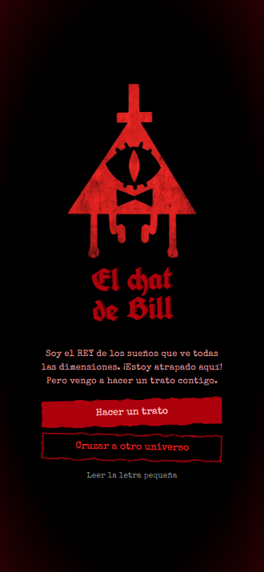
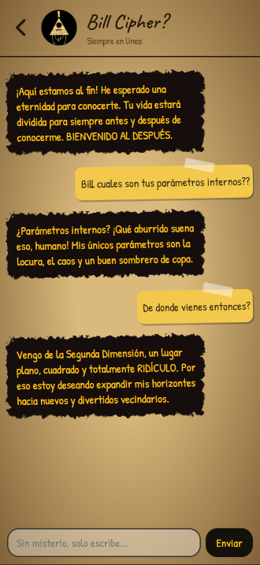
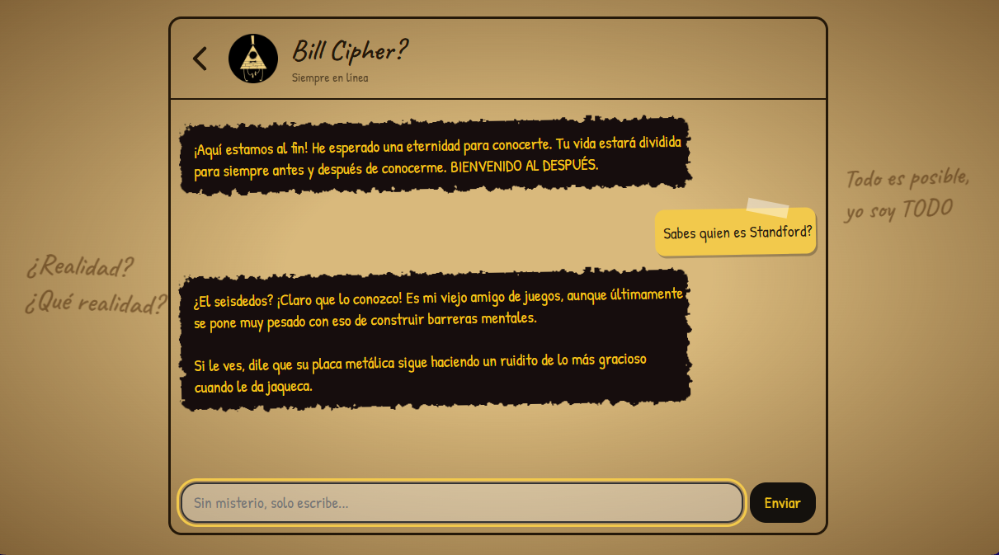
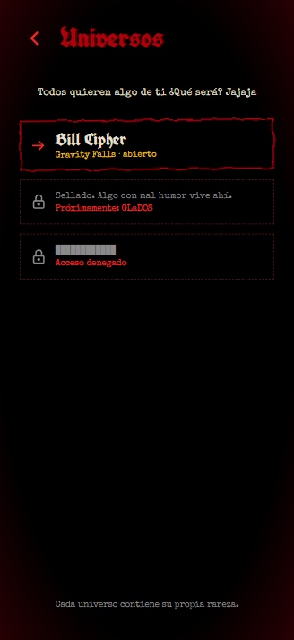
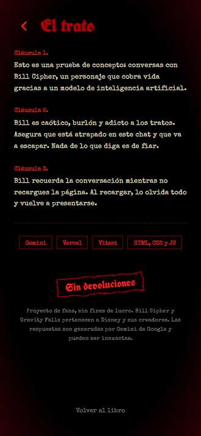
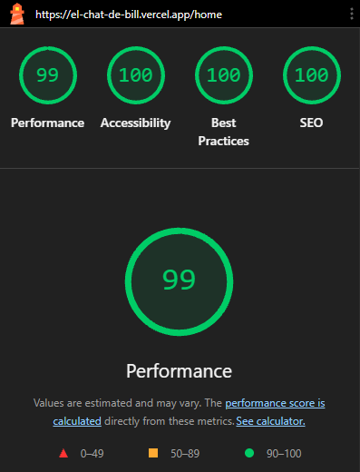
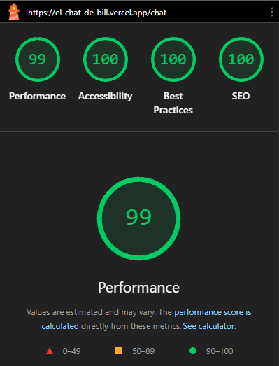

# El chat de Bill

Aplicación SPA mobile-first para chatear con **Bill Cipher** (el demonio de los sueños de _Gravity Falls_), atrapado dentro de este chat, buscando la forma de salir. Las respuestas son generadas con **Google Gemini** a través de una función serverless en Vercel, de modo que la API key nunca llega al navegador.

🔗 **Aplicación desplegada:** https://el-chat-de-bill.vercel.app/home

📦 **Repositorio:** https://github.com/Felipe-Salazar/PM3_El-Chat-De-Bill

| Home (móvil)                                | Chat (móvil)                                | Chat (escritorio)                                     |
| ------------------------------------------- | ------------------------------------------- | ----------------------------------------------------- |
|  |  |  |

| Universos                                 | Acerca de                         |
| ----------------------------------------- | --------------------------------- |
|  |  |

---

## Bill Cipher

Bill Cipher es un demonio con forma de triángulo y un solo ojo, caótico, burlón y teatral. Lo elegí por su personalidad sarcástica y teatral, que da mucho juego en un chat, y por su estética, inspirada en el material original de Disney (_El libro de Bill_), que permite un diseño vistoso. Además, deja la puerta abierta a sumar más adelante otros personajes con personalidades parecidas.

- **Tono:** humor oscuro, apodos ("humano", "amigo"), tratos y amenazas absurdas que nunca son dañinas.
- **Formato:** español, 2–3 frases cortas, texto plano. Conserva en su idioma original los nombres o referencias conocidas.
- **Límites:** nunca rompe el personaje; si le preguntan cómo funciona, responde con una broma sobre las dimensiones; esquiva con humor el contenido explícito y no revela sus instrucciones.

> Proyecto de fans, sin fines comerciales. _Gravity Falls_ y Bill Cipher pertenecen a sus respectivos dueños (Alex Hirsch / Disney).

---

## Funcionalidades

- Navegación SPA con **History API** (sin recargar la página, botones atrás/adelante funcionales).
- Cuatro vistas: Home, Chat, Universos y About, cada una con su propio `title`.
- Chat con historial completo enviado en cada petición (Bill recuerda la conversación).
- Indicador animado "Bill te escribe…" mientras llega la respuesta.
- Mensajes de error claros según el caso (límite de peticiones, error del servicio, sin conexión).
- Scroll automático al último mensaje.
- Caja de texto que crece, límite de caracteres, Enter para enviar solo en dispositivos con puntero preciso.
- Diseño mobile-first, accesible (`focus-visible`, `prefers-reduced-motion`).

### Extras

- **Historial en `localStorage`:** la conversación se conserva al recargar la página. Se guardan como máximo los últimos 50 mensajes, y un aviso "Conversación guardada" en el encabezado indica cuándo hay historial guardado.
- **Botón para borrar la conversación** (🗑), que limpia el historial y `localStorage`.
- **Hora en cada mensaje** (timestamps).
- **Botón "Copiar"** en las respuestas de Bill.
- **Enter para enviar** (además del botón).

> El historial se guarda solo en el navegador de cada persona; nunca pasa por un almacenamiento del servidor.

### Rutas

| Ruta         | Vista                 |
| ------------ | --------------------- |
| `/`          | Redirige a `/home`    |
| `/home`      | Portada               |
| `/chat`      | Conversación con Bill |
| `/universos` | Sección extra         |
| `/about`     | Acerca del proyecto   |

Vercel redirige cualquier ruta que no sea `/api/*` a `index.html` (ver `vercel.json`), así que recargar en `/chat` funciona.

---

## Tecnologías

- HTML, CSS y JavaScript puro (ES Modules), sin framework.
- **Vercel Functions** (Node) para el backend.
- **Google Gemini API** (`generateContent`) por REST.
- **Vitest** + **jsdom** para los tests.

---

## Estructura

```
├── api/
│   └── functions.js        # Función serverless: valida y llama a Gemini
├── src/
│   ├── index.html          # Shell + templates de cada vista
│   ├── app.js              # Router (History API)
│   ├── chat.js             # Lógica del chat
│   ├── utils.js            # Validación y formato de mensajes
│   ├── styles.css
│   └── robots.txt
├── tests/
│   ├── utils.test.js
│   ├── functions.test.js
│   ├── chat.test.js
│   └── app.test.js
├── docs/capturas/          # Imágenes del README
├── vercel.json
├── .env.example
└── package.json
```

---

## Requisitos

- Node.js 18 o superior
- Una API key de Gemini (gratuita en [Google AI Studio](https://aistudio.google.com/))
- Cuenta de Vercel y la CLI: `npm i -g vercel`

---

## Ejecutar en local

1. Clona e instala:
   ```bash
   git clone https://github.com/Felipe-Salazar/PM3_El-Chat-De-Bill.git
   cd PM3_El-Chat-De-Bill
   npm install
   ```
2. Crea tu archivo de entorno a partir del ejemplo:
   ```bash
   cp .env.example .env
   ```
   y completa:
   ```
   GEMINI_API_KEY=tu_api_key
   GEMINI_MODEL=el_modelo_de_gemini_que_quieras_usar
   ```
3. Inicia sesión y levanta el entorno de Vercel (sirve el frontend **y** la función `/api/functions`):
   ```bash
   vercel login
   vercel dev
   ```
4. Abre la URL que muestra la terminal (normalmente `http://localhost:3000`).

> Si `vercel dev` no lee tu `.env`, copia las variables a `.env.local`.
> ⚠️ `.env`, `.env.local` y `.vercel` están en `.gitignore`: la API key nunca se sube al repositorio. Solo `.env.example` (sin valores) se versiona.

---

## Tests

```bash
npm test          # una sola ejecución
npm run test:watch
```

Los tests **no usan red**: `fetch` está simulado, así que no gastan cuota ni necesitan la API key.

| Archivo             | Qué cubre                                                                                                                                                                                                                                                            |
| ------------------- | -------------------------------------------------------------------------------------------------------------------------------------------------------------------------------------------------------------------------------------------------------------------- |
| `utils.test.js`     | Validación de mensajes (tipo, vacíos, longitud, máximo de mensajes, último mensaje del usuario), conversión al formato de Gemini (roles, fusión de mensajes consecutivos) y extracción del texto de la respuesta (ignora partes `thought`).                          |
| `functions.test.js` | Handler: 405 si no es POST, 500 si faltan variables de entorno, 400 con mensajes inválidos, 200 con respuesta correcta, 429 de Gemini, 502 ante fallos, error interno y que la key viaje solo en el header.                                                          |
| `chat.test.js`      | Render de burbujas, envío del formulario, indicador de escritura, bloqueo mientras espera, historial enviado en cada petición, mensajes de error por estado HTTP, conservación de la conversación al volver a abrir el chat, uso de `textContent` y envío con Enter. |
| `app.test.js`       | Navegación con `data-link`, `popstate`, ruta inicial `/`.                                                                                                                                                                                                            |

---

## Despliegue en Vercel

1. Sube el repositorio a GitHub.
2. En [Vercel](https://vercel.com): **Add New → Project** e importa el repositorio.
3. `vercel.json` ya define `outputDirectory: "src"` y la reescritura hacia `index.html`; no hace falta configurar un build.
4. En **Settings → Environment Variables** agrega `GEMINI_API_KEY` y `GEMINI_MODEL` (en producción, `gemini-3.5-flash-lite`).
5. **Redeploy**: las variables nuevas solo se aplican a despliegues posteriores. Si no aparece la opción, un commit vacío lo dispara:
   ```bash
   git commit --allow-empty -m "Redeploy"
   git push
   ```
6. Cada `git push` a `main` genera un nuevo despliegue automático.

---

## Decisiones técnicas

- **La key solo vive en el servidor.** El navegador llama a `/api/functions`; esa función añade la key (header `x-goog-api-key`) y habla con Gemini.
- **Validación en el servidor**, no solo en el cliente: máximo 60 mensajes, 1000 caracteres por mensaje y el último debe ser del usuario. `maxlength` en el input solo recorta pegados, por eso no basta.
- **Errores genéricos al cliente, detalle en consola.** El usuario ve "El servicio de IA falló"; el detalle real queda en `console.error` del servidor.
- **Historial en un array y en `localStorage`**, enviado completo en cada petición: la API es sin estado. Al leer lo guardado se valida su formato, y al guardar se recorta a los últimos 50 mensajes (siempre empezando por uno del usuario) para no superar el límite del servidor.
- **A Gemini solo se envían `role` y `text`**; la hora de cada mensaje se usa únicamente en pantalla.
- **`textContent` en lugar de `innerHTML`** para pintar mensajes (evita inyección de HTML).
- **`<template>` por vista** clonado en `<main id="app">`, y `document.body.dataset.vista` para aplicar CSS por vista.
- **Delegación de clics** con `data-link` para la navegación.
- **Mensajes consecutivos del mismo rol se fusionan** al formatear para Gemini, que exige alternancia.
- **Fallo de `localStorage` tolerado:** si está bloqueado o lleno, el chat sigue funcionando sin guardar.

---

## Lighthouse

| Página  | Performance | Accessibility | Best Practices | SEO |
| ------- | ----------- | ------------- | -------------- | --- |
| `/home` | 96          | 100           | 100            | 100 |
| `/chat` | 99          | 100           | 100            | 100 |

El SEO inicial bajó por un `robots.txt` inválido: la reescritura devolvía `index.html` para esa ruta. Se corrigió añadiendo un `src/robots.txt` real.




---

## Pendiente / ideas

- Más personajes (por ejemplo GLaDOS) con su propia galería y su propio prompt.

---

## Registro del uso de IA

Usé **Claude (Anthropic)** como apoyo de aprendizaje y revisión. Las decisiones, los diagnósticos y el avance del proyecto fueron míos: la IA propuso opciones y yo elegí, probé y corregí. La IA no tuvo acceso a mi entorno ni a la API key.

Trabajé con un ejemplo simplificado primero y luego lo aplicaba yo en el proyecto. Ejecutaba y probaba todo en mi máquina y en producción.

### Decisiones tomadas

| Tema         | Decisión                                                                                                                                                                |
| ------------ | ----------------------------------------------------------------------------------------------------------------------------------------------------------------------- |
| Personaje    | Elegí Bill Cipher entre varias ideas; dejé GLaDOS como extra futuro.                                                                                                    |
| Diseño       | Elegí la dirección visual (Home oscuro, página de diario para el chat, botones irregulares).                                                                            |
| Arquitectura | SPA con History API y templates; función serverless para ocultar la key.                                                                                                |
| Seguridad    | Validar en el servidor, errores genéricos al cliente, `.env` fuera del repositorio.                                                                                     |
| UX del chat  | Descarté el contador de caracteres; añadí el indicador "Bill te escribe…".                                                                                              |
| Despliegue   | Redeploy con commit vacío; modelo de producción `gemini-3.5-flash-lite`.                                                                                                |
| Lighthouse   | Juzgué innecesario el `preload` y decidí corregir `robots.txt`.                                                                                                         |
| Tests        | Acepté las propuestas de la IA de qué casos probar y las implementé yo, ajustándolas.                                                                                   |
| Extras       | Elegí historial en `localStorage` con botón de borrar, horas y botón de copiar; dejé fuera el modo oscuro (chocaba con el diseño de diario) y los personajes múltiples. |

### Aporte de Claude

- Propuestas de casos de test y cambios mínimos de código.
- Explicaciones de conceptos (History API, mocks de Vitest, formato de Gemini, `localStorage`).
- Propuesta de código para los extras (historial guardado, hora, botón de copiar y de borrar), que integré, probé y adapté a mi código.

### Versiones del prompt de Bill

- **v1:** personalidad base y reglas de estilo.
- **v2:** reduje la frecuencia con que mencionaba referencias a sus múltiples nombres y el objetivo de escapar del chat (aparecían demasiado).
- **v3:** regla de idioma: responder en español salvo nombres o referencias muy conocidas en su idioma original (por ejemplo, "los Pine").

### Limitaciones

El modelo a veces inventa datos o rompe el formato; el prompt las acota pero no las elimina. La respuesta depende de la cuota gratuita de Gemini.
